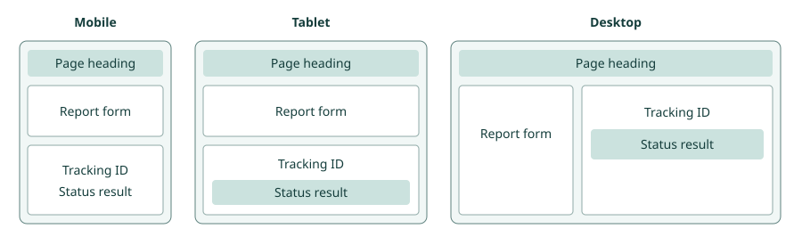

# Campus Safety Issue Reporter Design Note

A student who notices a campus hazard needs a way to record it and check whether it has been reviewed. Staff need to find and triage reports. The public view shows totals by status and category.

## Workflow and layout

The student submits a report and receives a tracking ID. Staff can filter reports, change status and add a note. The student uses the ID to see the updated status, and the public totals reflect the change.

| Viewport | Reporter | Staff |
| --- | --- | --- |
| Below 600px | Form and tracking stack | Filters and cards stack |
| 600px to 959px | Form and tracking stack with more space | Two report columns |
| 960px and above | Form and tracking panels sit side by side | Three report columns |

## Web Development Life Cycle

| Stage | Project work |
| --- | --- |
| Planning | Define the reporter, staff and public workflows for the class demo. |
| Analysis | Choose report fields, categories, statuses, tracking IDs and summary data. |
| Design | Sketch three viewport layouts and plan the order of headings, forms and controls. |
| Development | Use semantic HTML for structure and forms, CSS Grid and Flexbox for layout, and JavaScript arrays, functions, conditions and DOM events for interactions. |
| Testing | Check valid submission, whitespace, future dates, status tracking, filters, audit entries and storage. Verify layout at the three viewport sizes in a browser. |
| Deployment | Serve the static files or demonstrate them locally using the README steps. |

## Browser and server responsibilities

The browser renders the views, checks input, generates tracking IDs, filters and sorts records, and calculates summary counts. Demo data lives in memory and uses local storage for persistence on the same browser and origin when available. A static host delivers the HTML, CSS and JavaScript files. A real deployment would need a backend to authenticate users, enforce permissions and store reports securely.

## Manual checks

| Action | Expected result |
| --- | --- |
| Submit a blank report | The browser identifies the first required field. |
| Enter a future incident date | Validation blocks submission. |
| Submit a fictional issue | A new ID appears and the report starts at New. |
| Search for the ID in Staff | The matching report appears. An unmatched search shows an empty state. |
| Change status and save a note | The report and audit trail show both actions. |
| Look up the ID as Reporter | The updated status appears. |
| Open Public | Status and category totals appear. |
| Reload the page | Demo changes remain if storage is available. |
