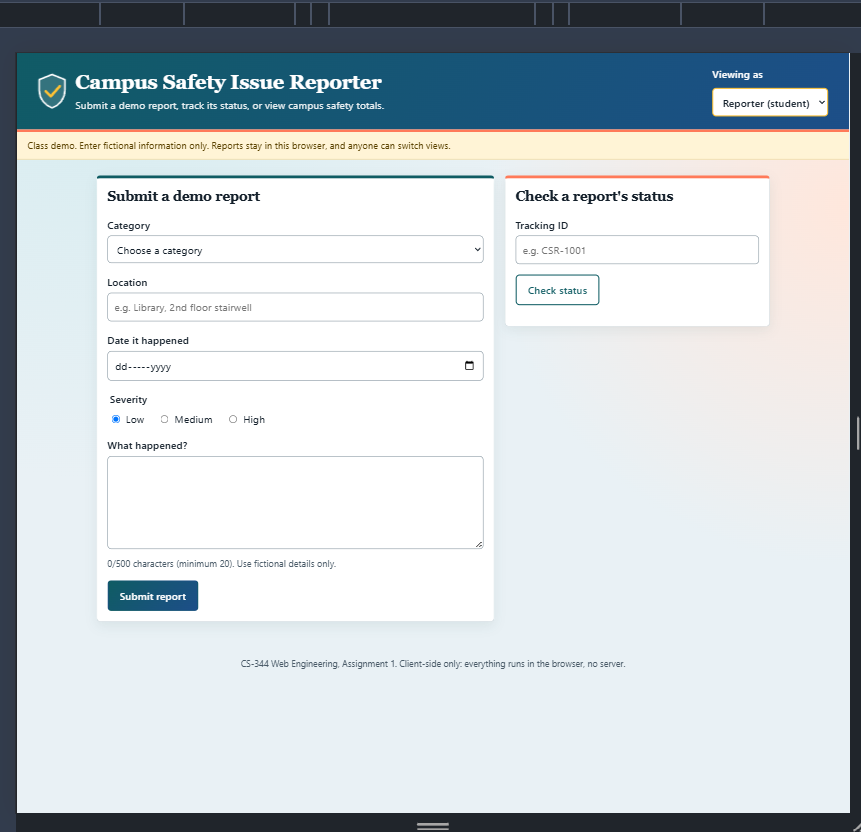
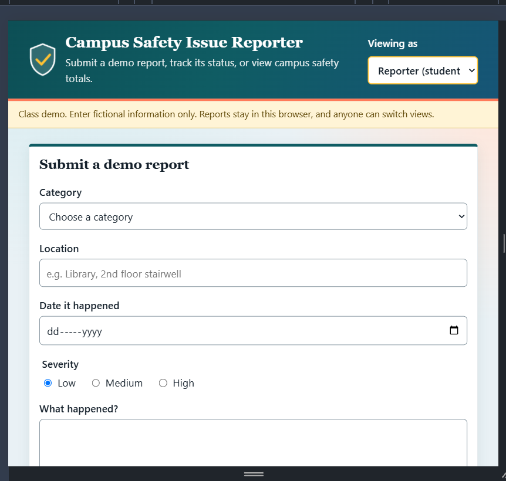
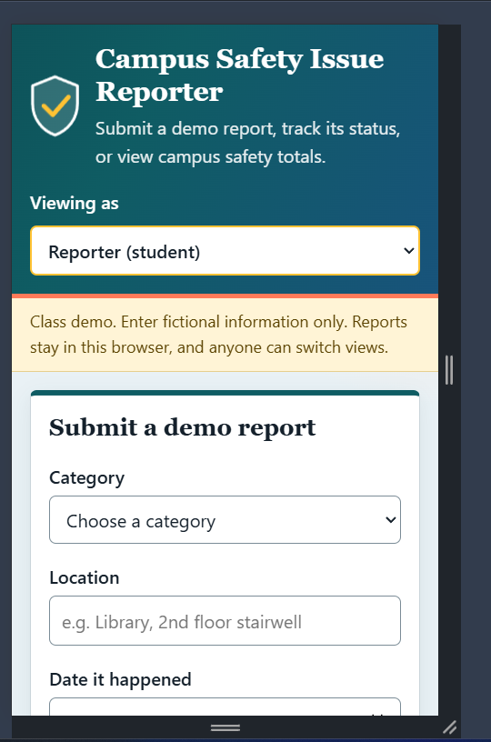

# Campus Safety Issue Reporter

CS-344 Web Engineering · Assignment 1 · Idea #26

## Demo walkthrough

1. As **Reporter**, submit a fictional issue with a category, location, date, severity and description. Copy the tracking ID.
2. Switch to **Staff** and search for the ID. Move the report to **In review** and save a fictional note. Check the audit trail.
3. Switch back to **Reporter** and look up the same ID. The result should show **In review**.
4. Switch to **Public** to see updated category and status counts.
5. For a live code change, edit the `In review` text in `PUBLIC_MESSAGES` in `app.js`. Reload and repeat the tracking lookup.

The browser starts with eight fictional records. It saves demo changes using local storage when available. Use the Staff view's **Reset demo data** button to restore the samples. The view switch simulates roles. All reports and notes are accessible within the demo browser.

## Design and screenshots

See the [design note](DESIGN_NOTE.md) and [wireframe](wireframe.svg).

### Responsive layout

| Desktop | Tablet | Mobile |
| --- | --- | --- |
|  |  |  |

### Workflow captures

| View | What the screenshot shows |
| --- | --- |
| [Filled report form](screenshots/05-report-form-filled.png) | A fictional report ready for submission. |
| [Submission confirmation](screenshots/06-report-confirmation.png) | The browser issues tracking ID `CSR-1009`. |
| [Reporter tracking lookup](screenshots/07-tracking-lookup.png) | The lookup returns **New** for the same report. |
| [Staff dashboard](screenshots/04-staff-dashboard.png) | The full report list with search, filters, and status controls. |
| [Staff search result](screenshots/08-staff-search.png) | Searching for `CSR-1009` narrows the list to one report. |
| [Public summary](screenshots/09-public-summary.png) | The category totals and status tiles. This capture predates the CSS fix that makes the **In review** tile and staff badge visible. |
